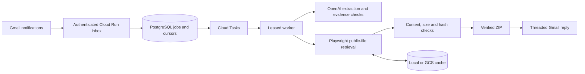

# FilingFetch

FilingFetch retrieves public Nova Scotia board filings from the UARB database. A request identifies one matter, one document category and up to ten files. The implemented email service interprets the request, retrieves eligible public attachments, validates them and composes a threaded reply with a ZIP.

**Status:** the CLI has limited live retrieval evidence and the email pipeline has local automated verification. The application is not deployed and live email delivery is unverified. See [release status](docs/release-status.md) for remaining requirements.

## Use the retrieval CLI

Requires Node.js 22 or newer:

```sh
npm ci
npm run browser:install
CACHE_BACKEND=off npm run fetch -- M12205 "Key Documents" --limit 1 --output outputs/example
```

For standalone use, keep DATABASE_URL unset. Results include accepted files, a verified ZIP when files are available, and report.json with source metadata, SHA-256 hashes, skips and warnings. Use a fresh output directory. Public data and source layout can change; read the report even when the command exits successfully. The default attachment budget is 20,000,000 bytes.

Supported categories: Exhibits, Key Documents, Other Documents, Transcripts and Recordings. Only rows explicitly marked Public are eligible. Missing visibility is not permission. Oversized, invalid and restricted files are skipped where recovery is possible.

## Architecture



PostgreSQL transactions protect cursor advancement and duplicate job insertion. Leases prevent independent concurrent processing of a job. An interrupted send remains uncertain until Sent-mail reconciliation; it is not blindly resent. These behaviors are tested locally, not claimed as hosted acceptance.

## Technologies

- TypeScript and Node.js 22: CLI, HTTP service, worker and scripts.
- Playwright/Chromium and Node streams: observed source navigation and bounded downloads.
- mailparser and Nodemailer: incoming MIME decoding and outgoing MIME composition.
- OpenAI Responses API and Zod: structured extraction followed by validation against request evidence.
- PostgreSQL with pg: job state, leases, inbox cursors and cache metadata. A hosted provider such as Neon is optional.
- Google Cloud Run, Cloud Tasks, Pub/Sub, Scheduler, Storage and Secret Manager: implemented deployment target and integrations; cloud verification remains pending.
- google-auth-library: OAuth refresh and caller identity validation.
- pdf-lib, file-type and fflate: PDF/content validation and ZIP creation/readback.
- Docker, Node's test runner, tsx, TypeScript checks and GitHub Actions: packaging and verification.

## Verification

```sh
npm test
npm run check
npm run test:browser
npm run build
npm audit --omit=dev --audit-level=moderate
```

`npm run test:integration` requires TEST_DATABASE_URL pointing to a disposable localhost PostgreSQL database named filingfetch_test or with that prefix. It uses unique test schemas and mocked external providers. CI runs the same checks using PostgreSQL 16. See [verification evidence](docs/verification-2026-11-09.md) for actual results, rather than treating a configured workflow as a passing run.

## Email service and deployment

A typical request is: “Please send the Other Documents for M12205.” Missing or invalid request fields produce a clarification. The dedicated mailbox address will be published only after it is configured and verified.

Follow [Gmail OAuth setup](docs/stage-16.md) and the [deployment and operations guide](docs/deployment.md). `npm run deploy:check` lists missing prerequisites without printing credentials. The Cloud Run deployment stays private and applies migrations before routing traffic. Do not expose it as a public unauthenticated endpoint.

## Limits

Live evidence covers one Key Documents PDF and an empty category. The initial Exhibits run returned a partial timeout. A subsequent live run rejected oversized H-1, recovered its modal and accepted H-2 without warnings. Other categories, broad pagination, hosted GCS behavior, actual model extraction and actual Gmail delivery are not fully verified. This is not an official board service. Verify authoritative information at the source and do not send confidential information to a demonstration mailbox.

[Retrieval contract](docs/retrieval-contract.md) · [Roadmap](docs/roadmap.md) · [Release status](docs/release-status.md) · [Privacy](docs/privacy.html)
